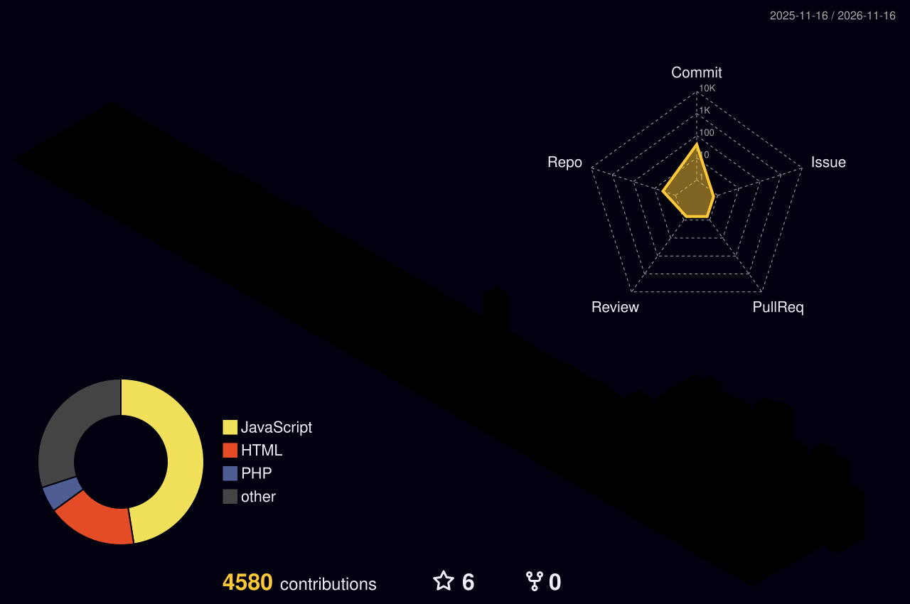
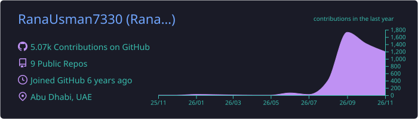
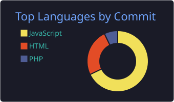

<a href="https://mrusman.com">
  
</a>

<p align="center">
  
</p>

<p align="center">
  <a href="https://www.linkedin.com/in/ranausman7330"></a>
  <a href="https://mrusman.com"></a>
  <a href="https://uaeprojects.com"></a>
  
  <a href="https://paypal.me/MrUsman7330"></a>
</p>

<br/>

## 🧹 Open Source: domsweep and websweep

<p>
  <a href="https://www.npmjs.com/package/domsweep"></a>
  <a href="https://github.com/RanaUsman7330/domsweep"></a>
  
  
</p>

**[domsweep](https://github.com/RanaUsman7330/domsweep)** checks a whole domain portfolio in one command: DNS, SPF/DKIM/DMARC, SSL certificates and registration expiry, with one report sorted by what is most broken. No dependencies, no account, no API key.

```bash
npx domsweep example.com
```

It comes out of the day-to-day work of looking after a large domain portfolio. [Read the README](https://github.com/RanaUsman7330/domsweep#readme) or [open an issue](https://github.com/RanaUsman7330/domsweep/issues) if it misses something.

**[websweep](https://github.com/RanaUsman7330/websweep)** is the companion that checks what each domain actually serves: http/https, www, redirect chains, HSTS and parked pages. Same idea, one report for the whole list.

<p>
  <a href="https://www.npmjs.com/package/websweep"></a>
  <a href="https://github.com/RanaUsman7330/websweep"></a>
</p>

```bash
npx websweep example.com
```

## 👋 About Me

<table>
<tr>
<td width="52%" valign="top">

I'm **Rana Usman**, a developer and business owner based in **Abu Dhabi, UAE**. I build **web platforms, APIs, developer tools and automation**, from property portals and admin panels to open-source command-line tools.

I spent **six years as a UI/UX and graphic designer** before moving into development, so I care as much about how a product *looks and feels* as how it *runs*.

Today I work across **technology, digital marketing and IT infrastructure**, looking after a large portfolio of domains and live websites.

- 🏙️ **Building:** web platforms, APIs and tools (Laravel, Node.js)
- 🌐 **Managing:** 1,200+ domains · 350+ websites
- 🛠️ **Side project:** free web tools at [mrusman.com](https://mrusman.com)
- 💬 **Ask me about:** Laravel, APIs, automation, DNS & hosting, UI/UX

</td>
<td width="48%" valign="top">

```php
<?php

namespace App\Developers;

class RanaUsman extends Developer
{
    public string $base = 'Abu Dhabi, UAE';

    public array $stack = [
        'backend'  => ['PHP', 'Laravel', 'REST APIs'],
        'database' => ['MariaDB', 'MySQL'],
        'frontend' => ['JavaScript', 'HTML', 'CSS'],
        'infra'    => ['Linux', 'Nginx', 'Cloudflare'],
        'design'   => ['Figma', 'Photoshop', 'Illustrator'],
    ];

    public function focus(): array
    {
        return [
            'Web platforms and APIs',
            'Developer tools and automation',
            'Fast, SEO-ready websites',
        ];
    }
}
```

</td>
</tr>
</table>

## 🚀 What I'm Building

<table>
<tr>
<td width="50%" valign="top">

### 🏢 [uaeprojects.com](https://uaeprojects.com)
A UAE real estate projects platform with its own **commercial API**, powering other property sites with live project data.

  

</td>
<td width="50%" valign="top">

### 🧰 [mrusman.com](https://mrusman.com)
My personal site with a growing set of **free web tools** for developers and marketers, running on a custom admin panel.

  

</td>
</tr>
</table>

## 🛠️ Tech Stack

<p align="center">
  <br/>
  <br/>
  
</p>

<p align="center">
  
  
  
  
  
</p>

## 🏙️ My Contribution Skyline

<p align="center"><i>A real estate developer's GitHub: every commit adds a floor.</i></p>

<p align="center">
  <picture>
    <source media="(prefers-color-scheme: dark)" srcset="https://raw.githubusercontent.com/RanaUsman7330/RanaUsman7330/main/profile-3d-contrib/profile-night-rainbow.svg" />
    <source media="(prefers-color-scheme: light)" srcset="https://raw.githubusercontent.com/RanaUsman7330/RanaUsman7330/main/profile-3d-contrib/profile-season-animate.svg" />
    
  </picture>
</p>

## 📊 GitHub Stats

<p align="center">
  
</p>

<p align="center">
  
  
</p>

<p align="center">
  
</p>

<p align="center">
  <picture>
    <source media="(prefers-color-scheme: dark)" srcset="https://raw.githubusercontent.com/RanaUsman7330/RanaUsman7330/output/github-snake-dark.svg" />
    <source media="(prefers-color-scheme: light)" srcset="https://raw.githubusercontent.com/RanaUsman7330/RanaUsman7330/output/github-snake.svg" />
    
  </picture>
</p>

## ☕ Support My Work

<p align="center">
  I build and share <b>free web tools</b> at <a href="https://mrusman.com">mrusman.com</a>. If something I made saved you time, you can buy me a coffee. It keeps these tools free for everyone.
</p>

<p align="center">
  <a href="https://paypal.me/MrUsman7330"></a>
</p>

<br/>


